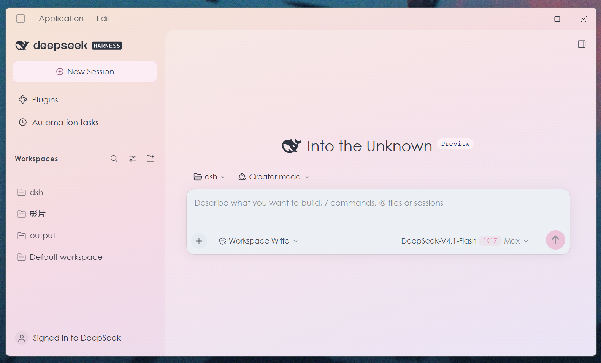
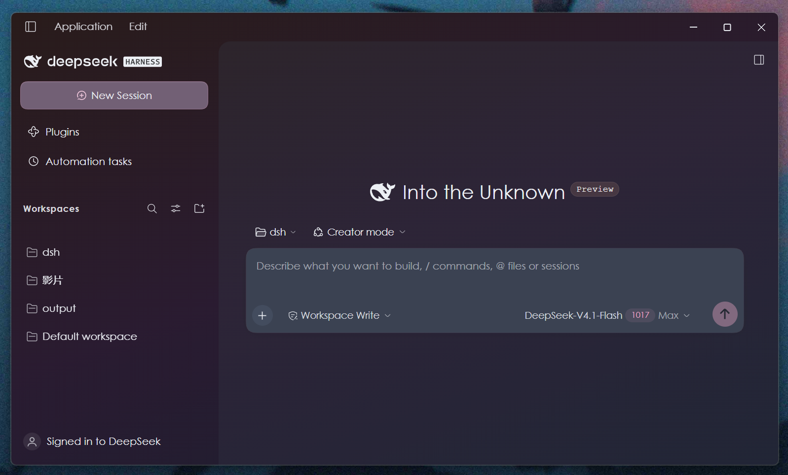
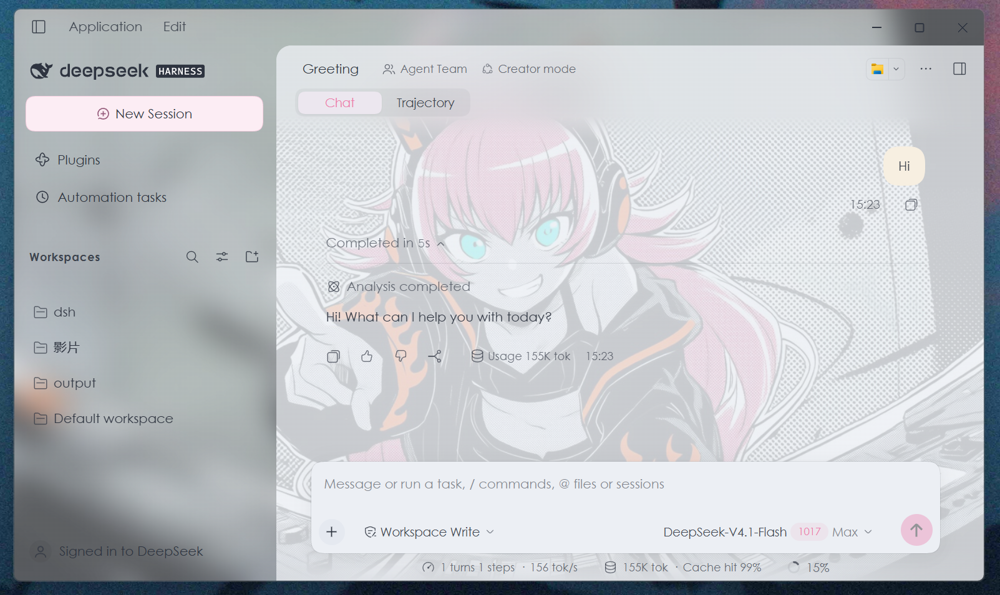
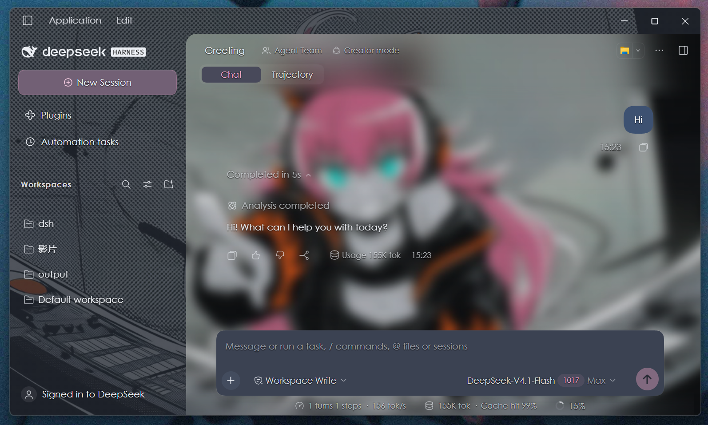

# Appearance Studio for DeepSeek Harness Desktop

[繁體中文](README.zh-TW.md) · [简体中文](README.zh-CN.md) · [English](README.en.md) · [日本語](README.ja.md)

An unofficial appearance plugin for the official **DeepSeek Harness Desktop** app: themes, wallpaper, frosted materials, corners, bubbles and typography, with refinements to chat, trajectory and built-in viewers.

**Target: official Windows Desktop 0.2.1-rc.2.** Standalone browser DSH, macOS, Linux and other versions are not listed as supported. The package’s `platform: web` field identifies the embedded Desktop Web Client API; it is not a browser-product support claim.

## Actual Desktop screenshots

Captured by the author in the official Desktop app. All four READMEs share these English-interface screenshots. They show example configurations, not exclusively default settings.

| Light gradient welcome screen | Dark gradient welcome screen |
| --- | --- |
|  |  |

**Frame and conversation blur and transparency (tint strength) are independently adjustable.** The two custom-image examples below show different combinations: changing one region does not require changing the other. The frame includes the top bar and left sidebar.

| Example A: blurred frame, sharp conversation background | Example B: sharp frame, blurred conversation background |
| --- | --- |
|  |  |

## Simulated settings previews

The Traditional/Simplified Chinese READMEs share Chinese settings screenshots; the English/Japanese READMEs use English settings screenshots. Rendered by the real plugin in an isolated React fixture; these are simulated previews, not native Desktop captures, and contain no private conversations. The plugin UI currently offers Chinese and English; four README languages do not mean four UI translations.


<details>
<summary>Simulated settings previews · Wallpaper / Typography</summary>


</details>

## Install and update

1. Confirm that official Desktop is **0.2.1-rc.2**. This release is gated to that exact tested runtime. Wait for validation of other versions instead of bypassing compatibility checks.
2. Download `dsh-appearance-studio-1.0.0.tgz` from [Releases](https://github.com/Goku-Raku/dsh-appearance-studio/releases/latest). Verify it against `SHA256SUMS.txt` on the same release. GitHub’s Source code archives are not the packaged plugin.
3. In Desktop, open Plugins → Add plugin and choose the package/Bundle installer, then enter the downloaded file’s full path. Alternatively ask the DSH agent using the prompt below. No separate browser DSH server is required.
4. After installation and activation, reload Desktop when safe to interrupt your work (usually Ctrl+R on Windows), then open Settings → Appearance Studio. Do not enable an old `@local/dsh-appearance-studio` development copy at the same time.
5. Back up appearance preferences before updating. Install the new release; if the host refuses duplicate installation, disable/remove the old package first without clearing appearance storage. Distribution is through GitHub Releases; npm publication and marketplace listing are not claimed.

> Use plugin_manager with action install_bundle to install my downloaded dsh-appearance-studio-1.0.0.tgz. Set target to its full local path and activate the Bundle.

## Features and accumulated refinements

| Area | Behavior |
| --- | --- |
| Themes and surfaces | Light, Dark and System; 9 surface choices, 11 accent presets and custom colors. One-click Catppuccin Latte/Mocha, Nord Snow/Polar mappings and Rosé Pine Dawn/Main preserve separate font, radius and blur tuning. |
| Backgrounds | 7 static gradients, None and Custom image. Custom image is preloaded with the author’s AI manga-style CHU² artwork from the Bonfire MV project. Fresh installs still select None; choose Custom image to display it. Replace/remove is supported and existing saved images are preserved. |
| Frame versus conversation | Top bar and sidebar use a deeper frame material; conversation content uses a separate reading surface. Independent frame/content tint, each 0–85%, and image blur, each 0–64 px. Defaults: frame blur 36 px, content 0 px. Gradient presets do not expose image-blur sliders. |
| Feathering and welcome screen | Fixed 36 px edge material and feathering remain independent of content blur. Welcome/loading views hide the top/bottom effect until an active conversation appears. No transparency through to other OS windows. |
| Bubbles and accents | Separate light/dark bubble palettes and remembered custom colors. Dark bubbles keep the chosen color with adjusted text contrast. Large primary actions use softer fills; send-button foregrounds remain readable. |
| Corners | Continuous 0–40 px with 0/16/40 shortcuts. Conversation lower-left stays square; upper-left also becomes square with the sidebar collapsed. Trajectory rows and dock seams have deliberate square exceptions. |
| Chat and composer | Content stops above the input; the small bottom seam is closed. Chat and trajectory keep the centered input card in the same position. Ordinary action tooltips appear above the composer. |
| Trajectory | A shared translucent background spans display and input areas. Full-width square record strips retain rounded controls/timeline above. About 8 px of scroll-aware edge fade disappears at either end so resting content stays legible. |
| Scrolling and motion | More visible light-mode scrollbars and conversation side index. Approximately 180 ms tab movement, 160 ms content fade and 260 ms sidebar transition, respecting reduced-motion preferences. |
| Menus, previews and dock | Large-radius hover decoration no longer clips text or shortcuts. File previews use consistent inset corners. Split built-in viewer edges are square; expanded lower-left is square. Internal cards and detached windows keep their own geometry. |
| Code and panels | Inline code keeps 60% fill opacity without fading its text. Code blocks and file cards retain their surfaces. Automation panels follow corner settings; sidebar hierarchy uses spacing and selected-row fills. |
| Three font roles | Separate interface/code/terminal families, sizes and per-mode text colors; searchable, lazy-loaded choices, manual names and explicit local-font refresh. Uses native host preferences, preserving syntax highlighting and ANSI colors. |
| Text clarity | Default/soft/high secondary-text contrast and off/subtle/crisp text shadow. CSS shadows do not affect canvas-rendered terminal text. |
| Compact controls | Small theme/wallpaper swatches; reduced radius-section spacing; side-by-side text controls. Typography aligns font/size on the left with preview/color on the right; combined swatch/hex fields wrap on narrow panels. |
| Performance and cleanup | Frame-batched updates and approximately 180 ms debounced saves. Images have a 1400 px maximum long edge; blur results at most 1100 px, with up to four cached strengths. No scroll-time DOM blur. Wallpaper shutdown/disposal clears owned observers and styles. |

## Usage

- Start with a mode and an open-source theme. Fine-tune accent, surface and wallpaper separately; applying a full theme changes only those three fields.
- Select Wallpaper → Custom image for the bundled artwork. Set content blur to 0 for a clear image; raise content tint first when text becomes hard to read. Frame and content sliders are independent.
- Fonts must exist on your own computer. The initial 402-name catalog is a development-machine snapshot, not bundled font files; missing fonts fall back. Only Refresh system fonts requests local-font access. Manual names still work when permission is refused.
- Custom colors are mode-specific. Default color clears the active override while remembering the last custom value. Switch to the intended mode before tuning its colors.
- Changes apply immediately. Page hiding and normal disposal flush pending saves; forcibly killing the process may lose the last brief burst of edits.

## Data, disabling and rollback

Appearance and images stay in the Desktop renderer’s `localStorage` (`dsh.appearance-studio.v2`, with v1 migration); family/size/mode use host preferences. Images are local Data URLs. Prefer input files below 2 MB; storage quotas vary. The plugin makes no network requests, executes no shell commands and requires no API key. That does not describe the host or other plugins. See [Security and privacy](SECURITY.md).

Disable through Desktop plugin management and reload at a safe time. Re-enabling retains settings. For a full appearance reset, use Reset appearance at the bottom; if manual cleanup is necessary, remove only the v2/v1 appearance keys, never all localStorage. Reset native fonts/mode separately in the host’s Appearance settings. Uninstalling should not remove chats or workspaces.

## Credits, licenses and disclaimer

Original code, documentation and CSS gradients use [MIT](LICENSE). Catppuccin, Nord and Rosé Pine notices and sources are retained in [Third-party notices](THIRD-PARTY-NOTICES.md) and [palette provenance](theme-sources.json). Matching gradients are this plugin’s adaptations, not official upstream wallpapers.

The bundled wallpaper is **NovelAI-generated fan art** from the author’s other repository, [灼熱 Bonfire! MV](https://github.com/Goku-Raku/shakunetsu-bonfire-mv), not official character art. It and screenshots containing it are outside MIT, limited to non-commercial fan creation and learning, and grant no character rights. Replace/remove it for commercial redistribution. See [asset provenance, hash and terms](assets/README.md).

Unofficial, with no affiliation or endorsement by DeepSeek, palette authors or character rights holders. Provided as is. Host internal DOM/hashed classes may change and break layout or interaction surfaces. No professional security audit, error-free behavior or broad cross-version guarantee is claimed. [Four-language disclaimer](DISCLAIMER.md) · [Validation and limits](docs/VALIDATION.md) · [Full changelog](CHANGELOG.md).

## Build a package from source

Node.js 20+, no runtime npm dependencies; Desktop provides React. `npm run check` validates release files, the embedded image and local documentation links; `npm pack` creates the installable archive. Personal profiles and internal handoff documents are excluded.

```sh
npm run check
npm pack --dry-run
npm pack
```

Search terms: DeepSeek Harness appearance, DeepSeek Harness Desktop theme, DSH skin, DSH 皮肤, DSH 外观, wallpaper, frosted glass.
