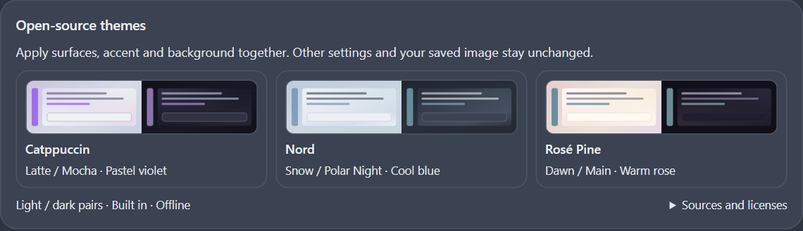
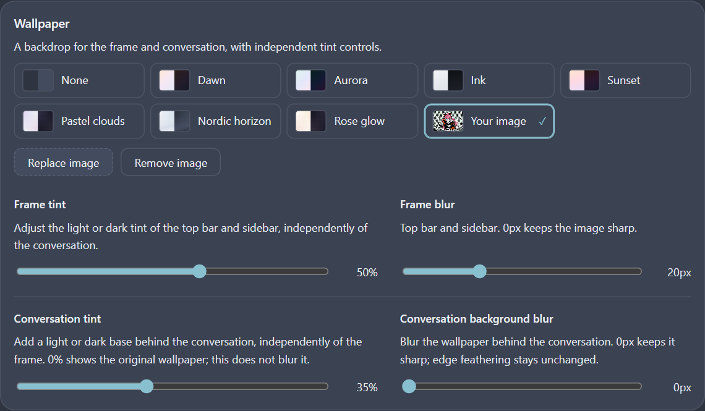
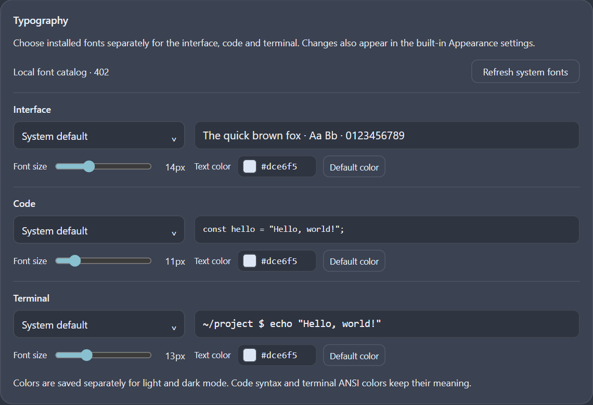

# Appearance Studio｜DSH Desktop 外観プラグイン

[繁體中文](README.zh-TW.md) · [简体中文](README.zh-CN.md) · [English](README.en.md) · [日本語](README.ja.md)

公式 **DeepSeek Harness Desktop** 向けの非公式外観プラグインです。テーマ、壁紙、すりガラス風の背景、角丸、吹き出し、フォントに加え、会話・トラジェクトリ・内蔵ビューアーの表示を整えます。

**対象：公式 Windows Desktop 0.2.1-rc.2。** 単独ブラウザー版、macOS、Linux、その他のバージョンは対応対象としていません。パッケージの `platform: web` は Desktop 内蔵の Web Client API を示し、ブラウザー版のサポートを意味しません。

## 設定画面のシミュレーション

繁体字・簡体字の README は中国語設定画面、英語・日本語の README は英語設定画面を使用しています。実際のプラグインを独立した React テスト画面で描画したシミュレーションです。ネイティブ Desktop の実写ではなく、私的な会話も含みません。プラグイン UI は現在中国語と英語です。README の4言語対応は UI の4言語対応を意味しません。



<details>
<summary>設定画面のシミュレーション · Wallpaper / Typography</summary>





</details>

## インストールと更新

1. 公式 Desktop が **0.2.1-rc.2** であることを確認してください。このリリースは検証済みの正確なバージョンに制限しています。他の版では互換性チェックを無理に回避せず、検証を待ってください。
2. [Releases](https://github.com/Goku-Raku/dsh-appearance-studio/releases/latest) から `dsh-appearance-studio-1.0.0.tgz` をダウンロードし、同じページの `SHA256SUMS.txt` で確認できます。GitHub の Source code アーカイブは配布用プラグインではありません。
3. Desktop の Plugins → Add plugin でパッケージ／Bundle のインストールを選び、ダウンロードしたファイルの絶対パスを入力します。下記の依頼を DSH Agent に渡す方法もあります。別途ブラウザー版 DSH を起動する必要はありません。
4. インストール・有効化後、作業を中断できるタイミングで Desktop を再読み込みします（Windows は通常 Ctrl+R）。Settings → Appearance Studio を開いてください。旧開発版 `@local/dsh-appearance-studio` と同時に有効化しないでください。
5. 更新前に外観設定をバックアップしてください。重複インストールを拒否された場合は旧パッケージを無効化・削除して新しい包を入れます。外観ストレージは消さないでください。配布先は GitHub Releases であり、npm やプラグイン市場への公開は主張していません。

> plugin_manager の install_bundle を使い、ダウンロード済みの dsh-appearance-studio-1.0.0.tgz をインストールしてください。target にはファイルの絶対パスを指定し、Bundle を有効化してください。

## 機能とこれまでの改善

| 項目 | 動作 |
| --- | --- |
| テーマ・配色 | Light／Dark／System、9 種のサーフェス、11 種のアクセントと任意色。Catppuccin Latte/Mocha、Nord Snow/Polar の対応付け、Rosé Pine Dawn/Main を一括適用し、フォント・角丸・ぼかしなどの個別設定は保持します。 |
| 背景 | 7 種の静的グラデーション、None、Custom image。作者の Bonfire MV 用 AI 漫画風 CHU² 画像を Custom image に同梱。初期選択は None のままです。Custom image で表示し、交換・削除も可能。保存済みの画像は上書きしません。 |
| 外枠と会話の分離 | 上部バー・サイドバーは落ち着いた外枠素材、会話は独立した読みやすい下地です。濃度はそれぞれ 0–85%、画像ぼかしはそれぞれ 0–64 px。初期値は外枠 36 px、本文 0 px。グラデーションでは画像ぼかし操作を表示しません。 |
| 上下のぼかし・新規会話 | 上下の固定 36 px 素材とフェードは本文のぼかしと独立。ウェルカム画面・読み込み中は上下効果を隠し、会話開始後に復帰します。背後の OS ウィンドウは透過しません。 |
| 吹き出し・アクセント | 明暗別の吹き出し色と任意色の記憶。ダーク時は選択した原色を保ち文字のコントラストを調整。大きな主操作ボタンは柔らかい塗り、送信ボタンは明瞭な前景色です。 |
| 角丸 | 0–40 px 連続調整と 0／16／40 のショートカット。会話の左下は直角、サイドバー収納時は左上も直角。記録行や Dock の継ぎ目には意図的な直角例外があります。 |
| 会話・入力欄 | 内容表示は入力欄の上で止まり、小さな下端の隙間を解消。会話／Trajectory 切替でも中央の入力カードの位置を統一。通常の操作ツールチップは入力欄より手前に表示します。 |
| Trajectory | 表示部と入力部を半透明の共通背景で接続。各記録行は直角で、上部ツールバーとタイムラインは角丸を維持。上下約 8 px のフェードは未表示内容がある側だけに適用し、端では文字を隠しません。 |
| スクロール・動き | ライト時のスクロールバーと会話のサイドインデックスを明瞭化。タブ約 180 ms、本文フェード約 160 ms、サイドバー約 260 ms の遷移。動きを減らす設定を尊重します。 |
| メニュー・プレビュー・Dock | 大きい角丸でもホバー装飾だけを切り抜き、文字やキー表示は隠しません。ファイルプレビューの内外角と余白を統一。半開ビューアーは直角、全開の左下も直角。内部カードと独立ウィンドウは維持します。 |
| コード・パネル | インラインコードの塗りを 60% にし、文字は薄くしません。コードブロックとファイルカードは個別の面を保持。自動化パネルは角丸設定に追従し、サイドバーは余白と選択色で階層を表します。 |
| 3 種のフォント | UI・コード・ターミナルそれぞれの書体、サイズ、明暗別文字色。検索、段階読み込み、名前の手入力、本機フォントの明示的な更新に対応。宿主設定 API を使い、構文色や ANSI 色は保ちます。 |
| 文字の視認性 | 補助文字の Default／Soft／High contrast と、影の Off／Subtle／Crisp。影は CSS 文字が対象で、Canvas 描画の端末文字には適用しません。 |
| コンパクトな設定 | 小さい配色見本、角丸セクションの余白削減、文字設定の左右配置。フォント／サイズを左、プレビュー／色を右に揃え、色見本と HEX を一体化。狭いパネルでは折り返します。 |
| 性能・終了処理 | 更新をフレーム単位でまとめ、操作停止約 180 ms 後に保存。画像長辺 1400 px、ぼかし結果 1100 px まで、最大4段階をキャッシュ。スクロール中の DOM ぼかしは使わず、無効化時に監視とスタイルを片付けます。 |

## 使い方

- まずモードとオープンソーステーマを選び、アクセント・サーフェス・壁紙を個別調整します。一括テーマが変更するのはこの3項目だけです。
- 同梱画像は Wallpaper → Custom image。鮮明な背景には Content blur を 0 にします。文字が読みにくい場合は本文の下地濃度を上げてから文字コントラストを調整してください。外枠と本文は独立です。
- 書体は自分の PC にインストールされたものを使用します。初期の402名称は開発機の一覧で、フォントファイルは付属しません。存在しない書体は代替表示になります。Refresh system fonts を押したときだけ権限を要求し、拒否時も手入力できます。
- 任意色は明暗別です。Default color は現在の上書きのみを解除し、以前の任意色は記憶します。調整するモードに切り替えてから変更してください。
- 変更は即時反映され、ページ非表示や通常終了時に未保存分を保存します。プロセスの強制終了では直前の短い連続操作が失われる場合があります。

## データ・無効化・復元

外観と画像は Desktop 内蔵ページの `localStorage`（`dsh.appearance-studio.v2`、v1 移行対応）に保存し、書体・サイズ・モードは宿主設定を使用します。画像はローカル Data URL です。入力画像は 2 MB 未満を推奨し、容量上限は環境によります。プラグイン自体は通信・Shell 実行・API Key を必要としません。宿主や他プラグインの挙動を保証するものではありません。[安全とプライバシー](SECURITY.md)。

一時停止は Desktop のプラグイン管理で無効化し、安全なタイミングで再読み込みします。再有効化では設定が残ります。初期化は下部の Reset appearance を使用してください。手動削除が必要な場合も v2／v1 の外観キーだけを対象とし、localStorage 全体は消さないでください。宿主の書体とモードは Appearance 設定で別途戻します。アンインストールで会話やワークスペースを削除する必要はありません。

## 出典・ライセンス・免責

独自コード・文書・CSS グラデーションは [MIT](LICENSE)。Catppuccin、Nord、Rosé Pine の MIT 文面・出典は [第三者表記](THIRD-PARTY-NOTICES.md) と [配色記録](theme-sources.json) にあります。背景グラデーションは本プラグイン独自の適用例で、上流の公式壁紙ではありません。

同梱壁紙は作者の別リポジトリ [灼熱 Bonfire! MV](https://github.com/Goku-Raku/shakunetsu-bonfire-mv) の **NovelAI 生成ファンアート**で、公式イラストではありません。画像と画像入りスクリーンショットは MIT の対象外で、非営利のファン創作・学習に限り、キャラクターの権利は付与しません。商用再配布時は交換・除去してください。[出典・ハッシュ・条件](assets/README.md)。

非公式であり、DeepSeek、配色作者、キャラクター権利者の提携・公認はありません。現状有姿で提供します。Desktop 更新による内部 DOM／ハッシュ付きクラス変更で表示や操作領域が崩れる場合があります。専門的な安全監査、無欠陥、広いバージョン互換性は主張しません。[4言語の免責事項](DISCLAIMER.md) · [検証と制限](docs/VALIDATION.md) · [変更履歴](CHANGELOG.md)。

## ソースからパッケージ化

Node.js 20+。実行時 npm 依存はなく、React は Desktop が提供します。`npm run check` で配布ファイル・埋め込み画像・ローカル文書リンクを検査し、`npm pack` でインストール用アーカイブを作成します。個人設定や内部引継ぎ文書は含みません。

```sh
npm run check
npm pack --dry-run
npm pack
```

検索キーワード：DeepSeek Harness appearance、DeepSeek Harness Desktop theme、DSH skin、DSH 皮肤、DSH 外观、デスクトップテーマ、壁紙、すりガラス。
