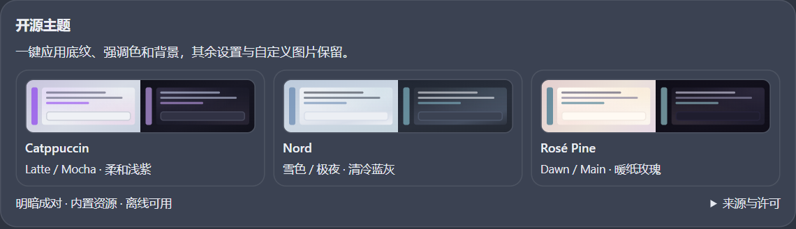
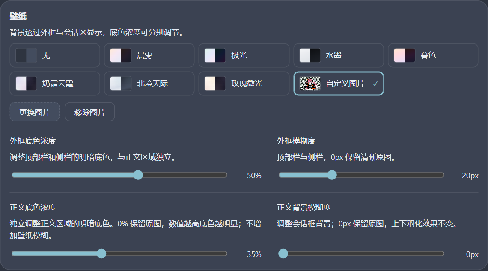
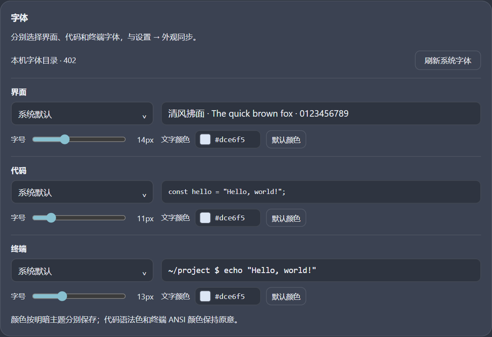

# Appearance Studio｜DSH 外观工作室

[繁體中文](README.zh-TW.md) · [简体中文](README.zh-CN.md) · [English](README.en.md) · [日本語](README.ja.md)

为官方 **DeepSeek Harness Desktop** 制作的非官方外观插件：主题、壁纸、磨砂、圆角、气泡与字体，并改善对话、轨迹和内建查看窗口的细节。

**适用对象：Windows 官方 Desktop 0.2.1-rc.2。** 独立浏览器版、macOS、Linux 及其他版本尚未列为支持平台。包中的 `platform: web` 指 Desktop 内嵌的 Web Client API，并非浏览器版产品定位。

## Desktop 主界面实拍

以下为作者提供的官方 Desktop 实际截图，四语 README 共用英文界面图片。画面为演示设置，并非全部默认值。

| 浅色渐变欢迎页 | 深色渐变欢迎页 |
| --- | --- |
|  |  |

**外框和会话区可以分别调整模糊度与透明程度（底色浓度）。** 下方两张自定义图片示例展示不同的独立设置组合；调整一个区域，不必同时改变另一个区域。外框包括顶部栏和左侧栏。

| 示例 A：外框模糊，会话背景清晰 | 示例 B：外框清晰，会话背景模糊 |
| --- | --- |
|  |  |

## 设置界面模拟预览

繁中和简中 README 共用中文设置画面；英文和日文使用英文设置画面。图片由实际插件在隔离的 React 测试界面中渲染，不是原生 Desktop 实拍，也不包含私人对话。插件界面目前提供中文和英文，四语 README 不代表四语界面。



<details>
<summary>设置界面模拟预览 · Wallpaper / Typography</summary>





</details>

## 安装与更新

1. 先确认官方 Desktop 版本为 **0.2.1-rc.2**。本版采用精确版本限制；其他版本请等待验证，不建议强行跳过兼容性检查。
2. 从 [Releases](https://github.com/Goku-Raku/dsh-appearance-studio/releases/latest) 下载 `dsh-appearance-studio-1.0.0.tgz`，可用同页 `SHA256SUMS.txt` 核对。不要把 GitHub 的 Source code 压缩包当成已打包插件。
3. 在 Desktop「插件 → 添加插件」中选择包／Bundle 安装方式，输入下载文件的完整路径；也可把下方请求交给 DSH Agent。无需另外启动浏览器版 DSH。
4. 安装并启用后，在工作可中断时刷新 Desktop（Windows 通常为 Ctrl+R），再进入「设置 → 外观工作室」。不要同时启用旧的 `@local/dsh-appearance-studio` 开发副本。
5. 更新前先备份外观设置，再安装 Releases 新包。如果宿主拒绝重复安装，先停用并移除旧包，再装新包；不要删除外观存储数据。目前通过 GitHub Release 分发，没有宣称已发布至 npm 或插件市场。

> 请用 plugin_manager 的 install_bundle 安装我下载的 dsh-appearance-studio-1.0.0.tgz，target 填该文件的完整本机路径，安装并启用此 Bundle。

## 功能与累计改进

| 区域 | 功能／行为 |
| --- | --- |
| 主题与底纹 | 明亮、深色、跟随系统；9 组底纹、11 套强调色及自选色。Catppuccin Latte/Mocha、Nord Snow/Polar 映射、Rosé Pine Dawn/Main 可一键搭配，保留字体、圆角、模糊等单独调整。 |
| 背景素材 | 7 组静态渐变、无壁纸、自定义图片。自定义图片预载作者「灼热 Bonfire! MV」中的 AI 漫画风 CHU² 图；初始壁纸仍为「无」，点「自定义图片」即可应用。可换图、移除，已有图片不被覆盖。 |
| 外框／正文分层 | 顶部栏和左侧栏用较沉的外框材质，会话正文使用独立阅读底色。两组底色浓度各 0–85%，两组图片模糊各 0–64 px；默认外框模糊 36 px、正文 0 px。渐变壁纸不显示图片模糊滑条。 |
| 羽化与新会话 | 会话上下保留固定 36 px 模糊材质与羽化，独立于正文模糊滑条；欢迎页及加载阶段先隐藏上下效果，正式会话自动恢复。不透出其他系统窗口。 |
| 气泡与强调色 | 明暗模式各自保存气泡颜色；自选色可切回且不丢失。深色气泡显示所选原色并调整文字对比。新会话／大型主按钮使用柔和填色，发送按钮维持清楚的前景。 |
| 圆角 | 0–40 px 连续调整，0／16／40 快捷点。会话左下固定直角，侧栏收起时左上也为直角；轨迹长条和内建查看窗口接缝有明确例外，不盲目应用圆角。 |
| 对话与输入框 | 内容只显示到输入框上方，修补下缘小缝隙；对话／轨迹切换时输入框位置一致、保留居中卡片形式，操作提示显示在输入框上层。 |
| 轨迹 | 显示区与输入区共享半透明底色，外缘贴边；每条记录固定直角，上方工具栏与时间轴保留圆角。列表上下约 8 px 羽化仅在还有内容可滚动时启用，两端静止不遮字。 |
| 滚动与动效 | 提高浅色滚动条和会话侧面索引可见度；对话／轨迹标签约 180 ms 滑动、内容约 160 ms 淡入，侧栏约 260 ms 过渡，遵循减少动态效果偏好。 |
| 菜单、预览与 Dock | 大圆角菜单只裁悬停装饰，不裁文字／快捷键；文件悬停预览统一内外角和留白。内建查看窗口半开固定直角，全开左下直角；内部卡片和独立浮动窗口不受影响。 |
| 代码与面板 | 行内代码保留 60% 底色且文字不变淡；整块代码、文件卡片保留各自表面。自动化面板圆角跟随设置，侧栏以留白和选中底色区分层次。 |
| 三类字体 | 界面、代码、终端分别选择字体、字号与明暗文字色；支持搜索、分批滚动、手动输入或刷新本机字体。通过宿主字体 API 保存，不替换语法高亮或 ANSI 颜色。 |
| 文字清晰度 | 次要／三级文字对比有默认、柔和、高对比；文字阴影有关闭、轻柔、清晰。阴影适用 CSS 文字，不覆盖终端 Canvas 内容。 |
| 紧凑设置 | 主题和壁纸采用小色样；圆角区压缩上下留白；文字对比和阴影左右排列。字体区左列字体／字号，右列预览／颜色，色样和色值合并，窄面板自动换行。 |
| 性能与清理 | 逐帧合并外观更新，停止操作约 180 ms 后保存；图片长边最多 1400 px、模糊结果最多 1100 px，每图最多缓存 4 档模糊，滚动时不加 DOM 滤镜。关闭壁纸及卸载时清理相关观察器和样式。 |

## 怎么调整

- 快速搭配：先选主题模式，再选开源主题；需要细调时再改强调色、底纹和壁纸。整套主题只改变这三项。
- 使用自带图片：壁纸 → 自定义图片。正文想清晰就把正文模糊设为 0；文字不易读时先增加正文底色浓度，再调文字对比。外框与正文滑条各自独立。
- 字体以本机安装为准。内建 402 项名称是开发机快照，不附带字体文件；其他电脑可能回退到系统字体。只有点「刷新系统字体」才请求权限，拒绝也可手动输入。
- 自选颜色按明暗模式分开；「默认颜色」只取消当前覆盖，仍记得上次自选色。先切到要调整的模式再改颜色。
- 修改立即生效；页面隐藏和正常卸载会保存待写入设置，强制结束进程仍可能丢失最后一小段连续操作。

## 数据、停用与恢复

外观与图片存于 Desktop 内嵌页面的 `localStorage`（`dsh.appearance-studio.v2`，兼容 v1）；字体、字号与模式使用宿主偏好。图片以 Data URL 留在本机，建议输入文件小于 2 MB，实际配额因环境而异。插件自身不发送网络请求、不执行 Shell、不需要 API Key；这不代表宿主或其他插件也离线。详见 [安全与隐私](SECURITY.md)。

临时停用：在 Desktop 插件管理停用，再于合适时刷新，重新启用可保留设置。完全恢复：先用外观工作室底部「恢复默认」；需要手动清除时，只移除 v2／v1 外观键，不要清空所有 localStorage。原生字体与模式请在宿主「外观」设置另行恢复。卸载不应删除聊天或工作区。

## 来源、许可与免责声明

代码、文档和原创 CSS 渐变采用 [MIT](LICENSE)；Catppuccin、Nord、Rosé Pine 的 MIT 许可凭证与来源见 [第三方声明](THIRD-PARTY-NOTICES.md) 和 [配色来源记录](theme-sources.json)。渐变背景是本插件的适配作品，并非上游官方壁纸。

自带图片为作者另一仓库 [灼热 Bonfire! MV](https://github.com/Goku-Raku/shakunetsu-bonfire-mv) 的 **NovelAI 生成同人图片**，不是官方角色图。图片及含图截图不属于 MIT，仅限非商业粉丝创作和学习；不授予角色权利，商业分发请替换／移除图片。完整来源、哈希和条件见 [assets/README.md](assets/README.md)。

本插件非官方，与 DeepSeek、配色作者或角色权利人无隶属／背书关系。按现状提供；内部 DOM／哈希类名可能随 Desktop 更新变化，造成显示或操作区布局异常。没有专业安全审计、无错误或跨版本保证。[四语免责声明](DISCLAIMER.md) · [验证证据与限制](docs/VALIDATION.md) · [完整改动](CHANGELOG.md)。

## 从源码打包

Node.js 20+，无运行时 npm 依赖，React 由 Desktop 提供。`npm run check` 检查发布文件、嵌入图片和本地文档链接；`npm pack` 生成安装包。包内不含私人配置或内部交接文档。

```sh
npm run check
npm pack --dry-run
npm pack
```

检索词：DeepSeek Harness appearance、DeepSeek Harness Desktop theme、DSH 皮肤、DSH 外观、桌面主题、壁纸、磨砂。
